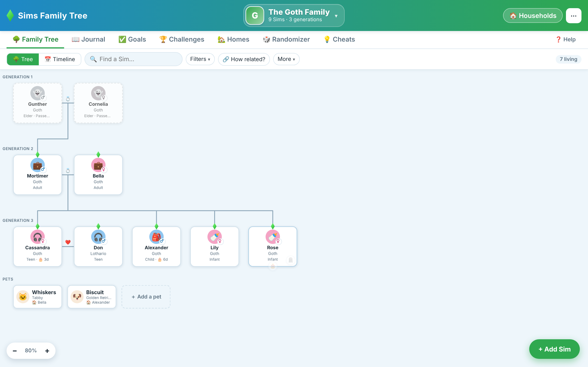
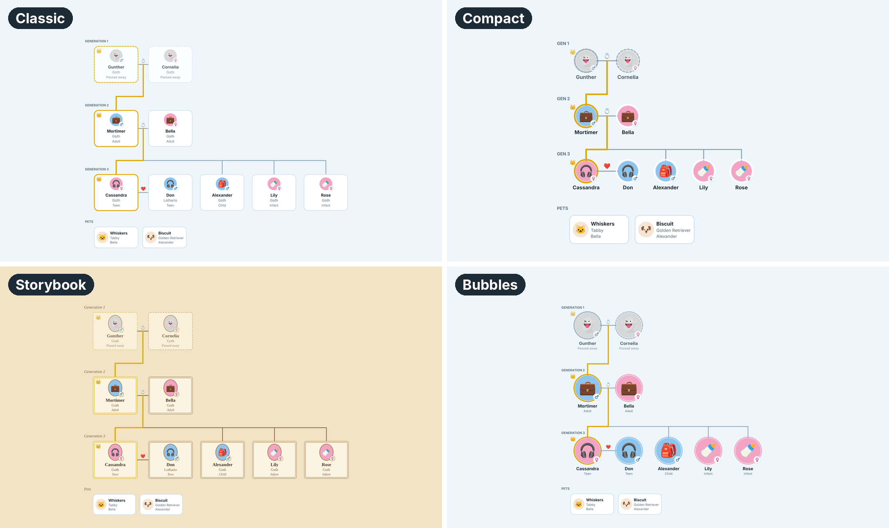
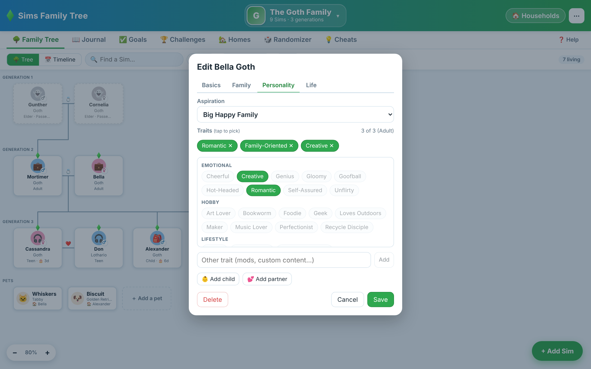
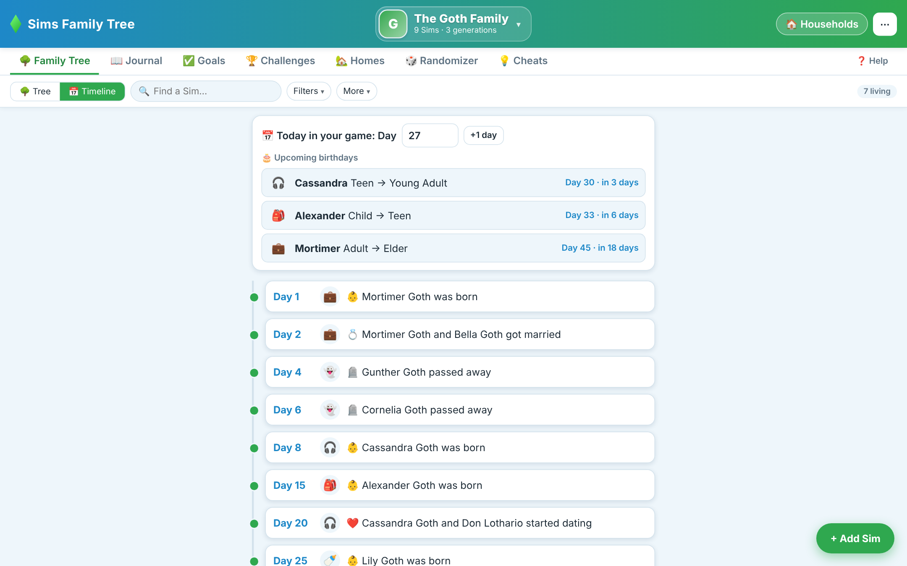
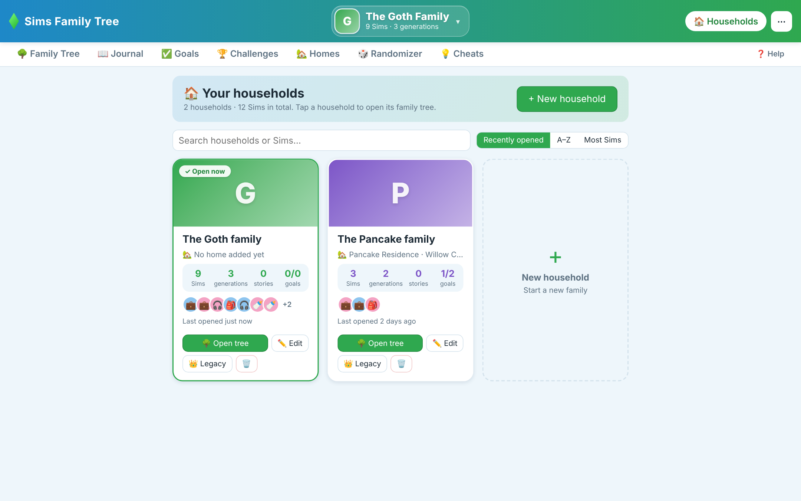
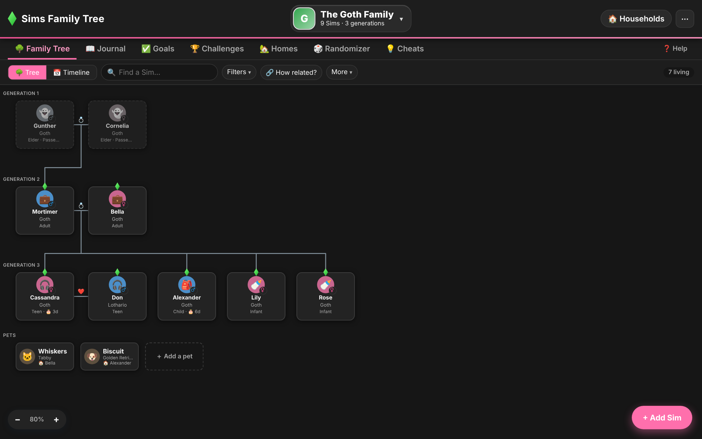
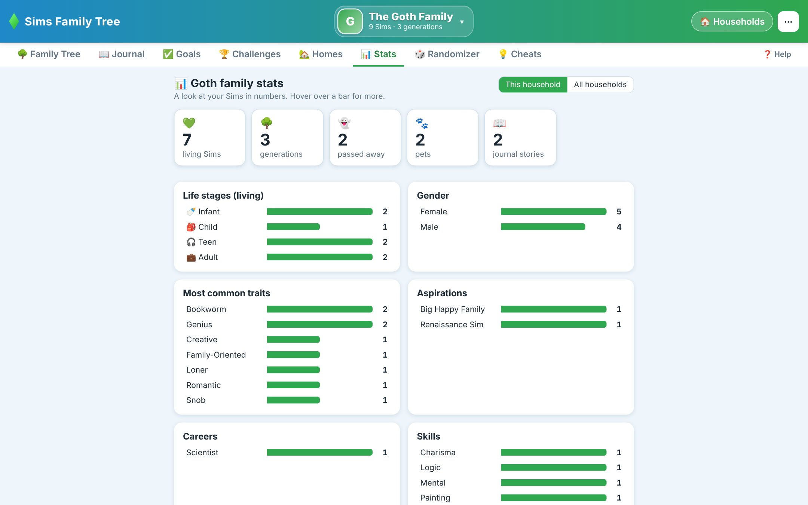
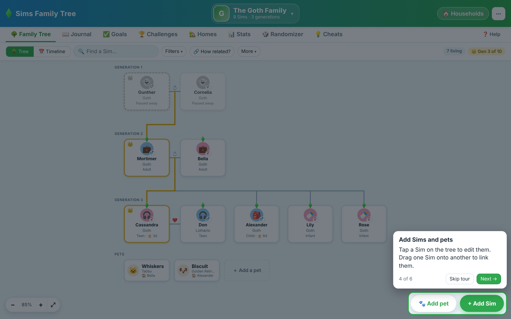
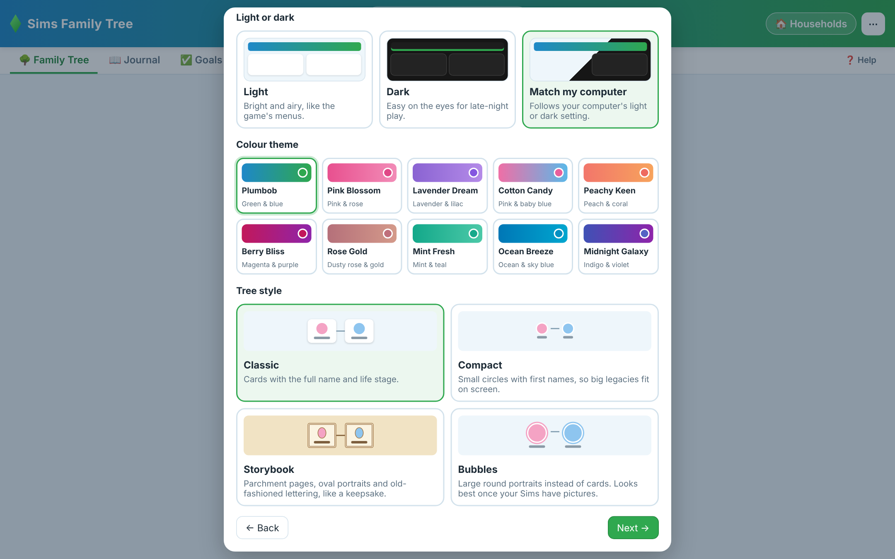

# 💎 Sims Family Tree

**Plan, track and remember your Sims 4 families — all in one cosy little app for Windows.**

Family trees · Tree styles · Legacy challenges · Pets · Birthdays · Journal · Stats · Cheats

&nbsp;

  

---

## ✨ What it does

<table>
<tr>
<td width="50%" valign="top">

### 🌳 Family trees that draw themselves
Add Sims and link them up — the tree lays itself out by generation, with partners side by side and children underneath.
- 💍 Married, 💖 engaged, ❤️ dating and 💔 exes
- 👯 Twins & triplets in one go
- 👐 Adopted children on a dotted line
- 🐾 Cats, dogs, horses and small pets
- 🫳 Drag one Sim onto another to link them
- 🔗 *How related?* — "second cousin once removed" and all
- 🎯 Focus on one Sim's family line, or ⤢ fit the whole tree on screen

</td>
<td width="50%" valign="top">

### 🎮 Brings in your families from the game
Point it at your Sims 4 save and tick the households — names, parents, partners, traits, careers, skills and pets come straight in. Your save is only read, never changed.

### 👩‍👧 Every Sim, the way they are in your game
- 📸 Paste a screenshot straight in (<kbd>Win</kbd> + <kbd>Shift</kbd> + <kbd>S</kbd>, then <kbd>Ctrl</kbd> + <kbd>V</kbd>) and zoom it to fit
- ⭐ Tap-to-pick traits, aspirations, careers, skills and occults
- 👶 One-click baby, 🎂 age up and 🪦 passed-away buttons
- 💭 Plan future Sims before they're born
- 📦 Only shows things from the packs **you** own
- ↩️ Deleted a Sim by mistake? Click **Undo**

</td>
</tr>
<tr>
<td colspan="2" valign="top">

### 🌳 Pick the look of your tree
**Classic** cards, **Compact** circles that fit a big legacy on screen, an old-fashioned **Storybook** page, or big round **Bubbles** for Sims with pictures. Saved pictures and prints match the look you pick.

</td>
</tr>
<tr>
<td valign="top">

### 👑 Legacies & challenges
Legacy laws and heirs with a golden heir line, plus Legacy, 100 Baby, Rags to Riches and Not So Berry checklists — or make your own.

</td>
<td valign="top">

### 📅 Your family's story
A timeline of births, birthdays, weddings and deaths, today's in-game day with upcoming birthdays, a journal with screenshots, goals for each Sim, and a **Stats** page with your families in numbers.

</td>
</tr>
<tr>
<td valign="top">

### 🏡 Households & homes
Every household as a card with its family picture, plus the world, lot and pictures of each home, and a board of building inspiration photos sorted by room. Sims can move out and stay in sync on both trees.

</td>
<td valign="top">

### 💡 Extras
A cheat sheet by category with copy buttons, a random Sim generator, 10 colour themes, dark mode, save-as-picture, and printing on one page or as a big poster to tape together. Plus **Undo for any change** (Ctrl + Z), bigger text, hiding tabs you don't use, Sims-style sounds and keyboard shortcuts.

</td>
</tr>
</table>

## 📸 A peek inside

<table>
<tr>
<td width="50%"> <b>Tap to pick</b> traits, aspirations, careers and skills</td>
<td width="50%"> <b>Timeline</b> with today's day and upcoming birthdays</td>
</tr>
<tr>
<td> <b>Households</b> at a glance</td>
<td> <b>Dark mode</b> + 10 colour themes (here: Pink Blossom)</td>
</tr>
<tr>
<td> <b>Stats</b>: your families in numbers</td>
<td> <b>Quick tour</b> for new players (with a Skip button)</td>
</tr>
</table>

---

## 🚀 Getting started

### 1. Download
Go to the **[latest release](https://github.com/Sagmire/sims-family-tree-releases/releases/latest)** and, under **Assets**, click **`Sims-Family-Tree-Setup-x.x.x.exe`**.

### 2. Install
Double-click the file you downloaded and follow the steps.

> [!NOTE]
> Windows may say **"Windows protected your PC"** because the app isn't from the Microsoft Store.
> Click **More info → Run anyway**. You only need to do this once.

### 3. Quick setup (about a minute)
The first time it opens, the app asks a few quick things — you can change all of them later from the **⋯** menu:

| Step | What it asks | Tip |
|:---:|---|---|
| 📦 | **Which packs you own** | Tap **Select all** if you have everything. Things from packs you don't own are hidden. |
| 💾 | **How to back up** | **Automatic** is easiest — your families are saved in the background. |
| 🎨 | **Pick a look** | Light, dark or match your computer, a colour theme, the tree style, and sounds on or muted. |
| 🎮 | **Bring in your families?** | Choose **Import from my game** to pick your save and households — or start fresh. |
| 🧭 | **Take a quick tour?** | A few short tips that show where everything is. Skip it if you like — it's in **❓ Help** any time. |

### 4. Start your first family
**Already playing?** Import your households from the game (in setup, or **⋯ → 🎮 Import from The Sims 4** any time). Your newest save is at the top of the list.

**Starting fresh?** Click **+ Create a household**, give it a name, then **+ Add Sim**. Only a first name is needed — fill in the rest whenever you like.

> [!TIP]
> Want to look around first? Click **Load an example family** on the welcome screen to load the Goths.

---

## 🔄 Updates

The app checks for new versions by itself. When one is ready you'll see a banner at the top:

1. Click **Download** (or **Later** if you're mid-game).
2. When it's done, click **Restart & update**. An "Updating…" screen shows while your families are backed up, then the app closes, updates and opens again by itself — with a list of what's new.

Your families are **backed up automatically before every update**, and nothing downloads or installs unless you click. To check straight away: **⋯ → 🔄 Check for updates**.

## 💾 Your families are safe

- Everything is saved on **your own computer** — no account, no internet needed.
- Automatic backups also go to **`Documents\Sims Family Tree Backups`**.
- **⋯ → Backups & restore** saves a backup file you can keep or copy to another PC, and undoes mistakes with one click.

## ❓ Need help?

Click **❓ Help** in the app — it explains every icon, line and button, with a search box and step-by-step "How do I…" answers. **🧭 Take the tour** at the top shows you around again.

 
Made with 💚 for Simmers. Not affiliated with or endorsed by Electronic Arts or Maxis. The Sims is a trademark of Electronic Arts Inc.

